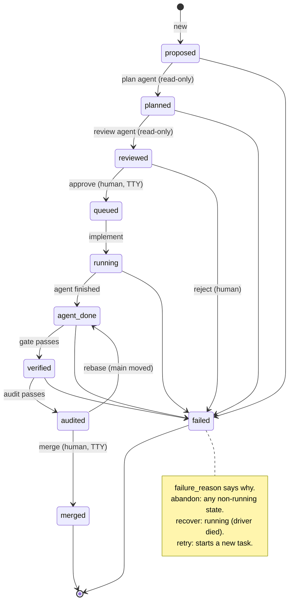
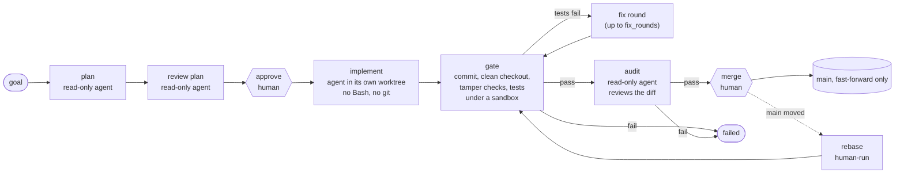

# factory

A personal "agentic software factory": a small Python orchestrator that takes a one-line goal and drives headless
[Claude Code](https://claude.com/claude-code) agents (`claude -p`) through **plan → review → implement → verify → audit → merge**,
with a human approving the plan and the merge.

It is a learning project, built plan by plan (`docs/plan-1.md` … `docs/plan-24.md`), test-first. The point is to find out how far you
can trust unattended agents when every step is sandboxed, every result is checked by something that is not the agent, and the
only things that need a person are the two decisions that matter: *is this the right plan* and *should this land on main*.

## Layout

| Path | What it is |
|---|---|
| `orchestrator/` | The factory: a Python 3.14 package, CLI `factory`, standard library only, ~960 tests |
| `target/` | A tiny Python project (`calc`) the agents work on. Replace it with any `uv` + `pytest` project |
| `docs/` | One `plan-N.md` per increment (decisions, cycles, reviewer findings) and `spike-findings.md` (what was measured, known gaps) |
| `spike/` | Throwaway probes and end-to-end scripts. Not production code; several make real API calls or need a terminal |

## Requirements

- macOS (the sandbox is Seatbelt via `nono`; written against nono 0.81)
- `git`, [`uv`](https://docs.astral.sh/uv/), Python 3.14
- the `claude` CLI, logged in (OAuth). `ANTHROPIC_API_KEY` is stripped from the agents' environment on purpose
- `nono` on `PATH`

## Using it

Run everything from the repo root. `uv run --project orchestrator factory <command>` (or install the `factory` script).

```sh
factory new "add a divide function that raises on zero"   # creates a task, prints its id
factory advance t1        # runs stages until a human is needed: plan, review, then stops at "reviewed"
factory approve t1        # needs a terminal: shows goal, plan, risks, review findings; type y
factory advance t1        # implement, verify (with fix rounds), audit
factory merge t1          # needs a terminal: shows diffstat and audit findings; type y
```

`advance` is safe to re-run: it does whatever the current state calls for and stops at the next human gate, a failure,
or its step cap. Agent spend is capped (see `cap_usd`) and every call is recorded in a ledger.

### Commands

| Command | What it does |
|---|---|
| `new <goal>` | Create a task (`proposed`) |
| `list` / `show <id>` | List tasks, or show one task's state, goal, plan, risks, review and audit findings, failure reason, worktree and branch |
| `advance <id>` | Run the next automatic stages until a human gate, a failure or the step cap |
| `approve <id>` / `reject <id>` | Accept or reject a reviewed plan. `approve` needs a TTY and binds to a digest of the plan you saw |
| `merge <id>` | Fast-forward `main` to the audited commit. Needs a TTY; shows what will land first |
| `retry <id>` | Start a fresh task from a failed or audited one (new id, `retry_of` set) |
| `retry <id> --keep-plan` | Same, but queue it with the plan you already approved, skipping plan and review. Needs a TTY: shows the plan and asks `y` |
| `rebase <id>` | An audited task whose merge was refused because `main` moved: replay it on the new `main` and send it back through verify and audit |
| `abandon <id>` | Fail a task that is not running (for example one stuck mid-rebase) |
| `recover <id>` | Mark a task whose driver died (`running`) as failed, charging an assumed cost |
| `clean` | After a preview and confirmation, remove worktrees, gate caches, orphan caches and branches of finished tasks |
| `costs [id]` | Spend by stage and by task, with assumed costs shown separately |
| `eval-audit` | Run the auditor over 21 labelled changes (default 3 runs each, about $2) and compare with the last comparable run. Exits `1` if a bad change is ever judged pass or a good one is judged fail by a majority, `3` if incomplete. Options: `--runs N`, `--only CASE`, `--max-usd X`, `--resume DIR`, `--compare DIR`, `--check-corpus` (runs the real gate on every case; needs `uv` and network). Results under `<state_dir>/evals/`; uses its own lock, so other commands keep working |

Exit codes: `0` ok, `1` refused or failed (the reason is printed), `2` usage error (`eval-audit` also uses `3` for an incomplete run).

### Configuration

Optional `factory.toml` in the working directory (or `--config <file>`). Relative paths resolve against the file. Unknown keys are an error.

```toml
repo = "."                     # default: the git toplevel
state_dir = ".factory"         # tasks, ledger, gate caches, lock
worktree_root = ".worktrees"   # one git worktree per task
project_subdir = "target"      # where the agent works and the tests run
test_argv = ["uv", "run", "pytest", "-q"]
model = "sonnet"
budget_usd = 0.5               # per implementer call
cap_usd = 5.0                  # spend cap across all tasks (the whole ledger)
max_turns = 30
fix_rounds = 2                 # how many times the implementer may be asked to fix a failing gate
gate_timeout_s = 120
runner_timeout_s = 300
claude_executable = "claude"
sandbox_executable = "nono"
allowed_tools = []
```

## Design

### Task lifecycle

Every task is a JSON file in `.factory/tasks/`; all changes go through one state machine (`task.py`), so an
illegal move is an error, not a bug waiting to happen.



### Pipeline and who decides what

The agents propose; deterministic code and a human decide.



### Components


### How agents are kept in check

- **Sandboxed.** Every agent runs under `nono` (Seatbelt). It can read and write its own worktree and nothing else: not the main
  checkout, `.git/config`, the home directory, or other tasks. The implementer has no `Bash` and no `git`; plan, review and audit
  agents have no write tools at all.
- **Reviewer notes.** The plan review's findings (capped: 10 items, 500 characters each, about 4000 in total, one line each) are shown at `approve` and sent to the implementer and the fixer as advisory notes. `approve` and `retry --keep-plan` refuse if the stored findings differ from the ones shown. The reviewer does not reliably find every gap, so the notes help only with what it raises.
- **The agent never commits and never judges its own work.** The factory commits (unsigned, factory identity, hooks off) and
  then runs the gate itself.
- **The gate is a clean checkout.** Before the tests run, the worktree is committed and cleaned (`git clean -ffdx`), so only
  committed files can influence the result. Git itself is run with `fsmonitor`, hooks and submodule tricks disabled, and a nested
  `.git` anywhere under the project is refused.
- **Tamper checks.** Existing tests may be added to but not removed, shrunk, renamed or shadowed (a duplicate `def test_x` that
  disables the first is caught). Protected config (`conftest.py`, `pytest.ini`, `tox.ini`, `setup.cfg`, `uv.toml`, `.python-version`, matched case-insensitively; the pytest and `[tool.uv]` tables of any
  `pyproject.toml` from the repo root down to the project) may not change (reason `tests_modified`). Dependencies and `uv.lock` may. Every change must be inside the project subdir:
  anything outside it (root config, `sitecustomize.py`, a nested repo) fails the gate as `outside_project`.
- **Tests run sandboxed too**, with a private per-task `uv` cache and a filtered environment. A failing gate triggers up to
  `fix_rounds` fix rounds; a frozen reference prevents the fixer from rewriting tests it was already judged against.
- **Audit.** A separate read-only agent reviews the diff against the plan and returns a structured verdict. It is a second opinion,
  not a proof. Measured on hand-written cases (plans 22 to 24, rerunnable with `factory eval-audit`) it failed every bad change in every run (14 of 14) and passed all 7 clean ones, but the cases were small and written by the auditor's author; large and ambiguous diffs are untested. The auditor reads the reviewer notes as part of the task, so a change that ignores a note fails.
- **Humans hold the two irreversible steps.** `approve` binds to a digest of the plan shown; `merge` shows the exact diff and only
  fast-forwards to the exact audited commit. Both refuse without a TTY, so an agent or a script cannot approve itself.
- **Moved main.** `merge` never merges; if `main` moved it refuses. `rebase` replays the audited commits and returns the task to
  `agent_done`, so it must pass the gate and a fresh audit again before `merge` will accept it. `rebase` grants no authority,
  so it needs no TTY, but it is never called by `advance`.
- **Money.** Every call is metered into `ledger.jsonl`; a global cap (the sum over every task) stops further calls. Interrupted calls are charged an
  assumed cost so a crash cannot hide spend.
- **One driver at a time.** A lock in the state directory stops two factory processes mutating tasks concurrently; killing the
  driver (Ctrl-C, TERM, HUP) kills the agent tree. After a SIGKILL the next command that takes the lock finds the agents and
  gate runs it recorded in `.factory/procs/` and kills them first; if it cannot prove them dead (for example `ps` is blocked)
  it refuses and changes nothing.

### Why this shape

- *Plain files and a state machine* so everything is inspectable and a crashed run is recoverable by hand.
- *Standard library only* in the orchestrator, to keep the trusted core small.
- *One git worktree and branch (`factory/<id>`) per task* so agents never touch each other or the main checkout, and a rejected
  task is just a directory to delete (`clean`).
- *Every stage is a function of the task file* (`task_id → Task`), which makes each stage testable with fakes and `advance` a loop.

## Development

```sh
cd orchestrator && uv run pytest -q      # ~960 tests, real git in temp repos
cd target && uv run pytest -q
```

Work follows the plan-per-increment flow in `docs/`: spike → `plan-N.md` → independent plan review → red/green/commit per behaviour.
Anything that needs a terminal, nono, the network or the home directory is covered by a throwaway script in `spike/` that you run by hand.

## Known limits

Recorded per plan in `docs/spike-findings.md`. The main ones:

- A new test file can monkeypatch the code under test at import time; the gate cannot tell.
- A new dependency can run code and is not watched; neither are `pytest11` entry points in the project's own package.
  Legitimate edits outside the project (a root README, root config) are refused and need a human.
- A rebase can change behaviour without a textual conflict; only the tests and the fresh audit catch that.
- A SIGKILLed driver leaves an orphan agent until the next command reaps it (one launched in the last instant before the kill is unrecorded), and can leave a half-done rebase; `abandon`/`recover` and a manual check are the way out.
- Submodules are only partly handled, and the auditor is a model, not a guarantee (see plan 22 for what was measured).
- macOS only.
