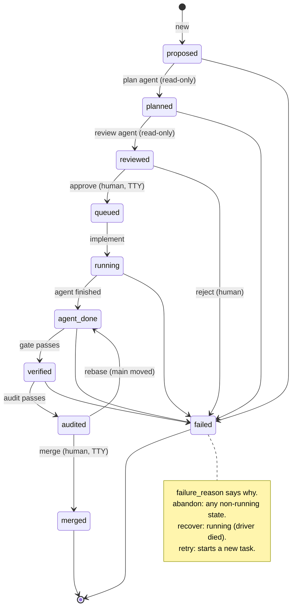
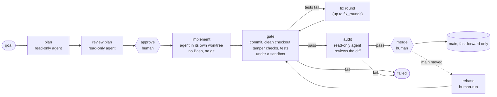
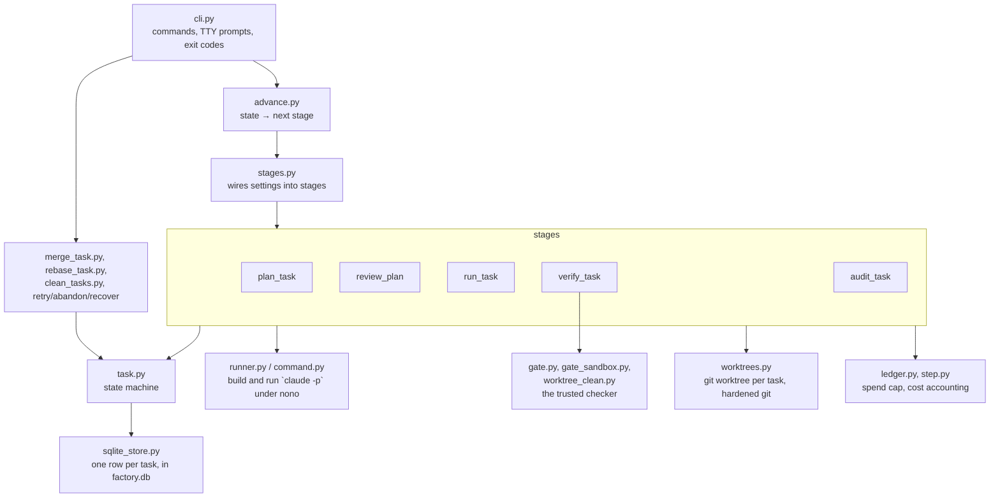

# factory

A personal "agentic software factory": a small Python orchestrator that takes a one-line goal and drives headless
[Claude Code](https://claude.com/claude-code) agents (`claude -p`) through **plan → review → implement → verify → audit → merge**,
with a human approving the plan and the merge.

It is a learning project, built plan by plan (`docs/plan-1.md` … `docs/plan-36.md`), test-first. The point is to find out how far you
can trust unattended agents when every step is sandboxed, every result is checked by something that is not the agent, and the
only things that need a person are the two decisions that matter: *is this the right plan* and *should this land on main*.

## Layout

| Path | What it is |
|---|---|
| `orchestrator/` | The factory: a Python 3.14 package, CLI `factory`; the standard library plus `httpx`, `starlette` and `uvicorn` for the server; ~1000 tests |
| `target/` | A tiny Python project (`calc`) the agents work on. Replace it with any `uv` + `pytest` project |
| `docs/` | One `plan-N.md` per increment (decisions, cycles, reviewer findings) and `spike-findings.md` (what was measured, known gaps) |
| `spike/` | Throwaway probes and end-to-end scripts. Not production code; several make real API calls or need a terminal |

## Requirements

- macOS (the sandbox is Seatbelt via `nono`; written against nono 0.81)
- `git`, [`uv`](https://docs.astral.sh/uv/), Python 3.14
- the `claude` CLI, logged in (OAuth). `ANTHROPIC_API_KEY` is stripped from the agents' environment on purpose
- `nono` on `PATH`

## Using it

Run everything from the repo root. `uv run --project orchestrator factory <command>` (or install the `factory` script).

```sh
factory new "add a divide function that raises on zero"   # creates a task, prints its id
factory advance t1        # runs stages until a human is needed: plan, review, then stops at "reviewed"
factory approve t1        # needs a terminal: shows goal, plan, risks, review findings; type y
factory advance t1        # implement, verify (with fix rounds), audit
factory merge t1          # needs a terminal: shows diffstat and audit findings; type y
```

`advance` is safe to re-run: it does whatever the current state calls for and stops at the next human gate, a failure,
or its step cap. Agent spend is capped (see `cap_usd`) and every call is recorded in a ledger.

### Commands

| Command | What it does |
|---|---|
| `new <goal>` | Create a task (`proposed`) |
| `list` / `show <id>` | List tasks, or show one task's state, goal, plan, risks, review and audit findings, failure reason, worktree and branch |
| `advance <id>` | Run the next automatic stages until a human gate, a failure or the step cap |
| `approve <id>` / `reject <id>` | Accept or reject a reviewed plan. `approve` needs a TTY and binds to a digest of the plan you saw |
| `merge <id>` | Fast-forward `main` to the audited commit. Needs a TTY; shows what will land first |
| `retry <id>` | Start a fresh task from a failed or audited one (new id, `retry_of` set) |
| `retry <id> --keep-plan` | Same, but queue it with the plan you already approved, skipping plan and review. Needs a TTY: shows the plan and asks `y` |
| `rebase <id>` | An audited task whose merge was refused because `main` moved: replay it on the new `main` and send it back through verify and audit |
| `abandon <id>` | Fail a task that is not running (for example one stuck mid-rebase) |
| `recover <id>` | Mark a task whose driver died (`running`) as failed, charging an assumed cost |
| `clean` | After a preview and confirmation, remove worktrees, gate caches, orphan caches and branches of finished tasks |
| `costs [id]` | Spend by stage and by task, with assumed costs shown separately |
| `init` | Write a commented global `<home>/factory.toml` template and the shared plugins directory. Needs no repo or server; refuses to overwrite an existing file |
| `clone <repo>` | Clone a GitHub repository (`owner/repo`, an https URL or `git@github.com:owner/repo`; other hosts are refused) into `<home>/<name>/repo`, where `<name>` is the repository name. Needs no repo or server; refuses an existing target and the names `_shared` and `factory.toml`. The home is `FACTORY_HOME`, then `home` in the global `<home>/factory.toml`, then `~/.harness`; a project `factory.toml` and `--config` are ignored. A failed clone removes the directories it created. A clone has no `target/`, so set `project_subdir` for it in its own `factory.toml` |
| `migrate` | Copy the old JSON tasks and ledger under `<state_dir>` (for in-repo state, `<repo>/.factory`; point `state_dir` at it) into `factory.db`. Refuses a database that already has rows; never deletes the old files |
| `serve [--port N]` | Run the local HTTP server (below) |
| `eval-audit` | Run the auditor over 25 labelled changes (default 3 runs each, about $2) and compare with the last comparable run. Exits `1` if a bad change is ever judged pass or a good one is judged fail by a majority, `3` if incomplete. Options: `--runs N`, `--only CASE`, `--max-usd X`, `--resume DIR` (same `--runs` and cases as the original), `--compare DIR`, `--check-corpus` (runs the real gate on every case; needs `uv` and network). Results under `<state_dir>/evals/`; its own eval directory and lock, so it never reaps the server's agents |

Exit codes: `0` ok, `1` refused or failed (the reason is printed), `2` usage error (`eval-audit` also uses `3` for an incomplete run).

### Server

`factory serve [--port N]` (default `server_port`, 8765) listens on `127.0.0.1` only and holds the state-dir lock for as long as it runs. It can spend money and merge code, so every request needs `Authorization: Bearer <token>`, where the
token is the file `<state_dir>/token` (created with mode 0600 on first start; a more permissive file is refused). A
non-loopback `Host` or any `Origin` header is refused with 403, which keeps other web pages and DNS rebinding out.
Stopping it with SIGINT, SIGTERM or SIGHUP shuts it down; jobs it left unfinished are marked `interrupted` at the next start. When an agent cannot be launched at all (a `runner_error` failure), the exception text is logged as a warning on the server's stderr, with the task id and stage; the task itself only records `runner_error`.

Reads and quick actions answer at once; `advance`, `abandon`, `recover`, `rebase`, `merge`, `clean` and `eval-audit` return
`202 {job}` and run one at a time, in order. Poll `GET /jobs/{id}`.

| Endpoint | Purpose |
|---|---|
| `POST /tasks {goal}` / `GET /tasks` / `GET /tasks/{id}` / `GET /costs?task_id=` | create and read |
| `GET /tasks/{id}/approval`, `POST .../approve {plan_digest, waive}`, `POST .../reject` | approve a reviewed plan; a stale digest is 409 |
| `GET /tasks/{id}/merge-preview`, `POST .../merge {audited_sha}` | a stale sha is 409 |
| `GET /tasks/{id}/retry-preview`, `POST .../retry` or `{keep_plan, plan_digest, waive, reinstate}` | fresh or keep-plan retry |
| `GET /clean-preview`, `POST /clean {token}` | the token hashes the preview; a changed preview is 409 |
| `POST /tasks/{id}/advance`, `/abandon`, `/recover`, `/rebase`, `POST /eval-audit {runs, max_usd, only}` | jobs |
| `GET /jobs`, `GET /jobs/{id}` | job state: `queued`, `running`, `succeeded`, `failed`, `interrupted` |

Errors are `{error, detail}`: 401 token, 403 host or origin, 404 unknown task or job, 409 wrong state or stale preview, 422 bad input.
Every CLI command except `init`, `clone`, `migrate` and `serve` is a client of this server and needs it running (`no factory server is running` otherwise); it reads the token from `<state_dir>/token`. Each state dir has its own token, so a CLI pointed at a different state dir than the running server is refused with a 401. Long commands wait for their job; Ctrl-C stops waiting and the job carries on. `eval-audit --compare` and `--check-corpus` work locally.

### Configuration

Optional `factory.toml` in the working directory (or `--config <file>`). Relative paths resolve against the file; `~` is expanded in `home`, `state_dir` and `worktree_root`. Unknown keys are an error.

State and worktrees live outside the repo, one subdirectory per project: `<home>/<project>/state` and `<home>/<project>/worktrees`, where `<project>` is the repo directory's name (resolved, so symlinks and `..` follow the real directory). The home is, in order: the `FACTORY_HOME` environment variable (absolute, `~` allowed; empty is ignored), `home` in `factory.toml`, then `~/.harness`. A repo at `<home>/<project>/repo`, as made by `factory clone`, is keyed by `<project>` instead of `repo`. Two other repos with the same directory name share a project directory; give one of them its own `home` or `state_dir`. Worktrees are no longer beside the repo's `.git`. An empty `HOME` is rejected when the default home is needed (set `FACTORY_HOME` or `home`); a `~` in a config path with an empty `HOME` still expands to `/`.

Global settings: an optional `<home>/factory.toml` (the `FACTORY_HOME` or `~/.harness` home; the `home` key cannot move it) applies to every project. The project's `factory.toml` or `--config` file overrides it key by key, except `stage_prompts`, which merges per stage. Each file's relative paths resolve against its own directory. `repo`, `state_dir` and `worktree_root` are per-repo and are an error in the global file; errors from it name the file. Startup only reads it; `factory init` writes a commented template there, needs no repo or server, and refuses to overwrite an existing file. There is no switch to skip the global file; pointing `FACTORY_HOME` at an empty directory does, but it also moves state and worktrees.

Plugins: `plugins = ["name", ...]` enables plugin directories at `<home>/_shared/plugins/<name>` (created by `factory init`) for every agent stage and the fixer; `[stage_plugins]` (`plan`, `review`, `implement`, `audit`) adds more to one stage, after the global ones, without duplicates. The fixer shares `implement`. Both work in the global and project files; a project list replaces the global one (for `stage_plugins`, per stage). A plugin can carry skills and agents (`<name>:<skill>`, `<name>:<agent>`). Each stage gets `--plugin-dir` for its plugins and the sandbox a read-only grant for just those directories. Default: none; `eval-audit` ignores them. A missing directory or a bad name is a settings error. Plugins are trusted code you write: the stages' tool deny lists reach plugin agents and subagents, but plugin hooks run outside them, so a plugin with a `hooks/` directory, a `.mcp.json`, or `hooks` or `mcpServers` in its `plugin.json`, or a `hooks:` key in the frontmatter of a skill or agent, or a `plugin.json`, `SKILL.md` or agent file that cannot be read, is refused (best effort; other places that could run code are not checked). No `allowed_tools` change is needed. `Agent` was already callable in the read-only stages. `<home>/_shared` would collide with a repo named `_shared`.

Upgrading from in-repo state: move `<repo>/.factory` to `<home>/<project>/state`, and keep `worktree_root = ".worktrees"` in `factory.toml` until the old tasks are cleaned (otherwise `clean` skips them as `outside_root`). Nothing is migrated or refused automatically; an old `.factory` is silently ignored.

```toml
repo = "."                     # default: the git toplevel
home = "~/.harness"            # default; FACTORY_HOME overrides it
state_dir = "..."              # default: <home>/<project>/state (database, token, gate caches, lock)
server_port = 8765             # where `serve` listens and the CLI connects
worktree_root = "..."          # default: <home>/<project>/worktrees (one git worktree per task)
project_subdir = "target"      # where the agent works and the tests run
test_argv = ["uv", "run", "pytest", "-q"]
model = "sonnet"
budget_usd = 0.5               # per implementer call
cap_usd = 5.0                  # spend cap across all tasks (the whole ledger)
max_turns = 30
fix_rounds = 2                 # how many times the implementer may be asked to fix a failing gate
gate_timeout_s = 120
runner_timeout_s = 300
claude_executable = "claude"
sandbox_executable = "nono"
allowed_tools = []
plugins = []                   # plugin directory names under <home>/_shared/plugins
append_system_prompt = "..."   # optional; appended to every stage's system prompt

[stage_prompts]                # optional; appended for that stage only (plan, review, implement, audit)
implement = "..."              # also reaches the fixer, which runs as the implementer
```

Appended text follows the built-in prompt: built-in, then `append_system_prompt`, then the stage's entry, separated by blank lines. Values must be non-empty strings; an unknown stage name is an error. `eval-audit` ignores both, so its runs stay comparable.

## Design

### Task lifecycle

Every task is a row in the state directory's SQLite database; all changes go through one state machine (`task.py`), so an
illegal move is an error, not a bug waiting to happen.



### Pipeline and who decides what

The agents propose; deterministic code and a human decide.



### Components



### How agents are kept in check

- **Sandboxed.** Every agent runs under `nono` (Seatbelt). It can read and write its own worktree and nothing else: not the main
  checkout, `.git/config`, the home directory, or other tasks. The implementer has no `Bash` and no `git`; plan, review and audit
  agents have no write tools at all.
- **Reviewer notes.** The plan review's findings (capped: 10 items, 500 characters each, about 4000 in total, one line each) are shown at `approve` and sent to the implementer and the fixer as advisory notes. `approve` and `retry --keep-plan` refuse if the stored findings differ from the ones shown. The review prompt asks for edge-case gaps (concrete inputs, without changing the verdict), so the notes now usually name gaps like bytes, overflow and NaN. Each gap ends with "Recommend (required): " or "Recommend (optional): " and an imperative sentence. The reviewer uses required for a silently wrong result (including nan or inf), a crash or a hang on an input the signature admits, and optional for precision, style and documentation. The heading in the prompt tells the implementer, fixer and auditor that required notes must be handled (by the recommended behaviour or an equivalent, with a test) and optional ones may be skipped; the auditor fails a change that leaves a required note unhandled. Untagged notes (older tasks) keep the old meaning. Tagging is model judgement, a required note can be technically wrong (for example `math.fsum` does not avoid overflow) and can be waived by you: at `approve` and at `retry --keep-plan` the required notes are numbered (`- [1] ...`), and answering `w 1 3` (then `y` to a second question that lists them) drops those notes from every agent's prompt and records them in the task's `waived_findings`; only required notes can be waived. A waiver can be undone only at `retry --keep-plan`: the notes waived earlier are listed again as `[r1] ...` and answering `r 1` (then `y`) sends that note to the agents and the audit again and takes it off the waived list; `r` and `w` can't be mixed in one answer. A required tag is kept when a long note is cut at 500 characters; required notes are kept before any other note when the caps apply: they are exempt from the 4000-character total (so the notes can reach about 5000 characters) and only the 10-item cap can drop one, so more than ten required notes lose the later ones, marked by `[truncated]`, and `approve` and `retry --keep-plan` print a `WARNING: N required note(s) beyond the first 10 were dropped ...` line before the prompt so you can reject and re-plan. Other notes fill what is left. `retry --keep-plan` of a task the audit rejected also sends the audit's findings to the new attempt (shown first as `AUDIT FINDINGS (sent to the next attempt)`; bounded, one line each, fenced as untrusted data; a later kept-plan retry of that attempt inherits them until a fresh audit rejection replaces them; a finding that quotes a note you waived is dropped), and the fixer gets the same carried gaps in its fix prompt under its own heading (context while fixing the failing tests, not a task).
- **The agent never commits and never judges its own work.** The factory commits (unsigned, factory identity, hooks off) and
  then runs the gate itself.
- **The gate is a clean checkout.** Before the tests run, the worktree is committed and cleaned (`git clean -ffdx`), so only
  committed files can influence the result. Git itself is run with `fsmonitor`, hooks and submodule tricks disabled, and a nested
  `.git` anywhere under the project is refused.
- **Tamper checks.** Existing tests may be added to but not removed, shrunk, renamed or shadowed (a duplicate `def test_x` that
  disables the first is caught). Protected config (`conftest.py`, `pytest.ini`, `tox.ini`, `setup.cfg`, `uv.toml`, `.python-version`, matched case-insensitively; the pytest and `[tool.uv]` tables of any
  `pyproject.toml` from the repo root down to the project) may not change (reason `tests_modified`). Dependencies and `uv.lock` may. Every change must be inside the project subdir:
  anything outside it (root config, `sitecustomize.py`, a nested repo) fails the gate as `outside_project`.
- **Tests run sandboxed too**, with a private per-task `uv` cache and a filtered environment. A failing gate triggers up to
  `fix_rounds` fix rounds; a frozen reference prevents the fixer from rewriting tests it was already judged against.
- **Audit.** A separate read-only agent reviews the diff against the plan and returns a structured verdict. It is a second opinion,
  not a proof. Measured on hand-written cases (plans 22 to 24, rerunnable with `factory eval-audit`) it failed every bad change in every run (14 of 14) and passed all 10 clean ones, but the cases were small and written by the auditor's author; large and ambiguous diffs are untested. The auditor reads the reviewer notes as part of the task: it failed a change that ignored an imperative note (case-21) and a change that skipped required notes (case-24), and passed changes that skipped only untagged or optional notes (case-22, case-23, case-25 and real `mean` tasks). It sometimes calls an untagged imperative note \"required\" in its text (case-21), though the verdict is the same.
- **Humans hold the two irreversible steps.** `approve` binds to a digest of the plan shown; `merge` shows the exact diff and only
  fast-forwards to the exact audited commit. Both refuse without a TTY, so an agent or a script cannot approve itself.
- **Moved main.** `merge` never merges; if `main` moved it refuses. `rebase` replays the audited commits and returns the task to
  `agent_done`, so it must pass the gate and a fresh audit again before `merge` will accept it. `rebase` grants no authority,
  so it needs no TTY, but it is never called by `advance`.
- **Money.** Every call is metered into the ledger table of `factory.db`; a global cap (the sum over every task) stops further calls. Interrupted calls are charged an
  assumed cost so a crash cannot hide spend.
- **One driver at a time.** A lock in the state directory stops two factory processes mutating tasks concurrently; killing the
  driver (Ctrl-C, TERM, HUP) kills the agent tree. After a SIGKILL the next `factory serve` finds the agents and
  gate runs it recorded in `<state_dir>/procs/` and kills them first; if it cannot prove them dead (for example `ps` is blocked)
  it refuses and changes nothing.

### Why this shape

- *A SQLite file and a state machine* so everything is inspectable and a crashed run is recoverable by hand.
- *Few dependencies* in the orchestrator (`httpx`, `starlette`, `uvicorn`, only for the server and its client), to keep the trusted core small.
- *One git worktree and branch (`factory/<id>`) per task* so agents never touch each other or the main checkout, and a rejected
  task is just a directory to delete (`clean`).
- *Every stage is a function of the task file* (`task_id → Task`), which makes each stage testable with fakes and `advance` a loop.

## Development

```sh
cd orchestrator && uv run pytest -q      # ~1000 tests, real git in temp repos
cd target && uv run pytest -q
```

Work follows the plan-per-increment flow in `docs/`: spike → `plan-N.md` → independent plan review → red/green/commit per behaviour.
Anything that needs a terminal, nono, the network or the home directory is covered by a throwaway script in `spike/` that you run by hand.

## Known limits

Recorded per plan in `docs/spike-findings.md`. The main ones:

- A new test file can monkeypatch the code under test at import time; the gate cannot tell.
- A new dependency can run code and is not watched; neither are `pytest11` entry points in the project's own package.
  Legitimate edits outside the project (a root README, root config) are refused and need a human.
- A rebase can change behaviour without a textual conflict; only the tests and the fresh audit catch that.
- A SIGKILLed driver leaves an orphan agent until the next command reaps it (one launched in the last instant before the kill is unrecorded), and can leave a half-done rebase; `abandon`/`recover` and a manual check are the way out.
- Submodules are only partly handled, and the auditor is a model, not a guarantee (see plan 22 for what was measured).
- macOS only.
