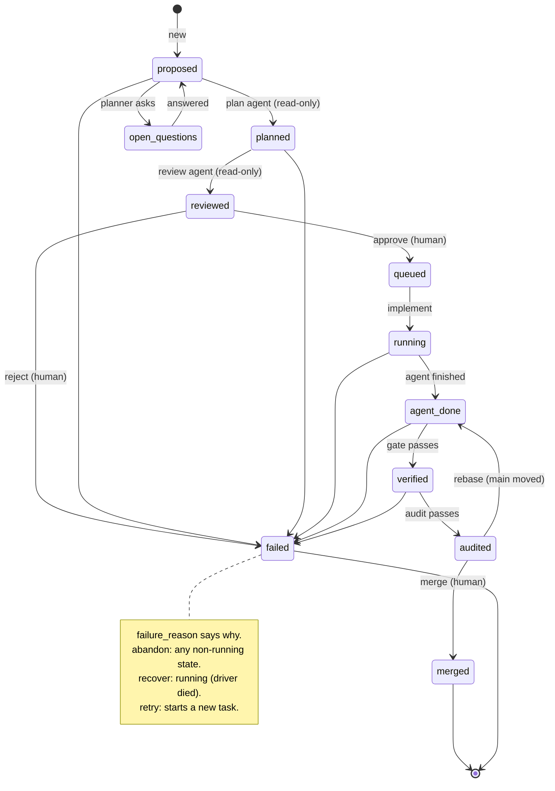
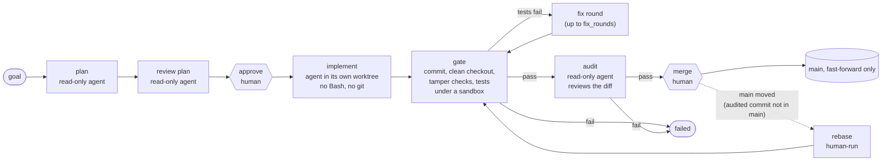
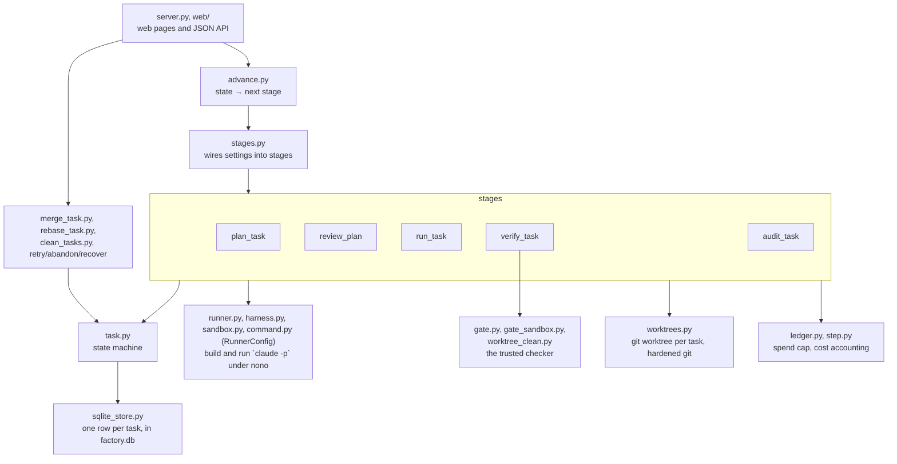

# factory

A personal "agentic software factory": a small Python orchestrator that takes a one-line goal and drives headless
[Claude Code](https://claude.com/claude-code) agents (`claude -p`) through **plan → review → implement → verify → audit → merge**,
with a human approving the plan and the merge (in the web UI).

It is a learning project, built plan by plan (`docs/plan-N.md`, one per increment), test-first. The point is to find out how far you
can trust unattended agents when every step is sandboxed, every result is checked by something that is not the agent, and the
only things that need a person are the two decisions that matter: *is this the right plan* and *should this land on main*.

## Quick start

### Requirements

- macOS or Linux (the sandbox is `nono` 0.81 or later). What was verified on each is in [Platform verification](#platform-verification). Windows is refused at startup (`launcher.py`), because factory needs `fcntl`, `pgrep`, `ps` and process groups. WSL is untested.
- `git`, [`uv`](https://docs.astral.sh/uv/), Python 3.14
- the `claude` CLI, logged in (OAuth). `ANTHROPIC_API_KEY` is stripped from the agents' environment on purpose
- `nono` on `PATH`

### Using it

Run everything from the repo root. `uv run --project orchestrator factory <command>` (or install the `factory` script).

```sh
factory serve             # start the local server
factory ui                # prints a one-time login link; open it in the browser
```

The browser is the only task interface: create, answer, approve, advance and merge tasks there. Advancing is safe to re-run: it does whatever the current state calls for and stops at the next human gate, a failure,
or its step cap. Agent spend is capped (see `cap_usd`) and every call is recorded in a ledger.

## Web UI

The server also serves a browser page under `/ui`. From it you can create tasks, answer, approve or reject plans, and advance, rebase, merge, abandon, recover and retry tasks, and view costs, jobs and what `clean` would remove. It is always on and uses the same port.

- `factory ui` prints a login link that works once, within 5 minutes. `factory ui --host NAME` prints the same link with its host replaced by NAME, keeping the link's port (a link with no port gives `http://NAME`), for opening it from another machine. The CLI checks NAME itself: it must be a loopback name or in the CLI's own `server_allowed_hosts`, otherwise it prints a usage error, exits 2 and asks the server for nothing. The CLI's settings may differ from the running server's, in which case the link gets 403. The login code is not tied to a host, so the server is unchanged. Opening it shows a page with a link to the UI and sets an HttpOnly, SameSite=Strict cookie `factory_session_<port>`, scoped to `/ui`. A link-preview tool can use up the code; run `factory ui` again.
- The page at `/ui/` lists each repo's tasks newest first, in one section per repo, marks the ones waiting on you, and updates live over server-sent events (`/ui/events`). Agent-written text in the list (goal, failure reason, task id, skipped names) is shown with control characters, invisible format characters and lone surrogates escaped, as on the task page.
- Each id in the list links to a per-task page at `/ui/repos/{repo}/tasks/{id}`. The page shows the state, goal or prompt, failure reason, plan, open questions, risks and review, audit and waived findings, attempts, denial count, worktree and branch, and errors, and marks a task waiting on you. It has no spend (see the costs view); its actions are the Answer, Approve and Reject links below. It updates live over its own stream (`/ui/repos/{repo}/tasks/{id}/events`), and sends an update only when that task's rendering changed since the last one on that connection, so another task's progress does not touch it. Both pages stream only while their tab is visible, so many open tabs do not use up the browser's connection limit for the server: a hidden or background tab holds no stream and shows the current state when you return to it, which resets any text selection and the scroll of a long block (each return opens a new connection, which always starts with the current state). An unknown or malformed id gives a 404 page that does not echo the id. A task whose stored row cannot be read gives an "unreadable" page (status 500) with no traceback, raw data or id.
- Markdown: the plan (task, approve and retry pages) and each question body (answer page) render as CommonMark, nothing more: raw HTML is shown as text, images show only their alt text, and only `http`, `https` and `mailto` links become links (any other target stays plain text). Links open in a new tab with `rel="noopener noreferrer"`. On the approve and retry confirm pages each link is followed by its target, `text (url)`, so a person approving sees where it goes. The same control-character escaping applies to the rendered output. Approval still binds to the raw plan text, not what is shown. Titles, risks and findings stay plain text.
- Style: the pages use sentence case for headings, labels, links, buttons and messages ("Goal: x", "Back to the task list"), and show states, stages, job kinds and job states humanised ("Open questions"). Stored values, URLs, JSON and logs stay raw, as do ids, branches, paths, code, goal and plan text, agent text, failure codes and job error text.
- A session unused for 8 hours expires (not configurable); every request the guard authenticates counts as use. An open live-update stream is not cut when its session expires; it ends when the page closes it or the server stops.
- Sessions live in memory, so restarting `serve` logs the browser out: the page should show a "Disconnected" banner (see the last bullet), also when you return to a tab that was hidden during the restart; run `factory ui` again.
- Under `/ui` the `Host` must be loopback or in `server_allowed_hosts` (same rule as the API: exact, case-sensitive, port ignored), an `Origin` must be absent or the server's own (reads; writes have a stricter rule, below), and `Sec-Fetch-Site` must be `same-origin` or `none`. Every UI response carries a strict Content-Security-Policy and `Cache-Control: no-store`. The JSON API stays Bearer-only: a cookie does not open it, and Bearer does not open `/ui`.
- Reject: the page of a task in state `reviewed` shows a "Reject this plan" link to `/ui/tasks/{id}/reject`. That confirm page shows the goal and one button, which POSTs (a plain form, answered with a 303 back to the task page). The task becomes `failed` with reason `plan_rejected_by_human`. A rejection costs work: a rejected task is terminal, and a retry only makes a new `proposed` task from the goal (grill answers are lost); keeping the plan is refused. Any other state, including a task that left `reviewed` meanwhile, gets a 409 page; a missing, malformed or unreadable id gets the 404 or 500 page. None of these pages echoes the id.
- Answer: the page of a task in state `open_questions` shows an "Answer these questions" link to `/ui/tasks/{id}/answer`. That page shows each question and has one text field per question, prefilled with the recommended answer; a blank field takes the recommended answer. The POST (a plain form, answered with a 303 back to the task page) moves the task to `proposed`. A page opened before a new round of questions arrived gets a 409 "questions changed" page. The form body is parsed by hand (no `python-multipart`): urlencoded only, at most 64 KiB, a repeated `round` or answer field is refused, and a bad form gets a 422 page.
- Approve: the page of a task in state `reviewed` also shows an "Approve this plan" link to `/ui/tasks/{id}/approve`. That confirm page shows the goal, plan, risks and the review findings (capped, required notes numbered, and the warning when required notes beyond the cap were dropped), and one button. The POST binds to the digest of the plan shown, queues the task (303 back to the task page) and waives nothing unless you tick boxes: the page offers a checkbox for each required note (its escaped text is the value; an unknown or ambiguous value is a 409 page and nothing is approved), and a ticked note is not sent to the agents or enforced by the audit. Required notes you leave unticked stay in the agent prompt and the audit, except any listed as dropped. The JSON `waive` field does the same. Known limit: the approve form binds only the plan digest, not the notes shown; the notes are read again when the form is posted, so a stale choice is refused but a note added since the page loaded is accepted without being shown. A changed plan gets a 409 "plan changed" page, and a task in any other state a 409 page. A missing, malformed or unreadable id gets the 404 or 500 page; none of these pages echoes the id.
- There is no TTY check: `factory ui` mints a login code with the Bearer token, as the JSON `approve` and `answer` endpoints have none, so anything that can read the token can also approve through a browser session. This adds no power beyond the token.
- Writes under `/ui` (any method but GET and HEAD) also need an `Origin`: exactly the server's own (`http://<Host>`), or the string `null` together with `Sec-Fetch-Site: same-origin`. UI responses send `Referrer-Policy: same-origin` (it was `no-referrer` before plan 74), so a same-origin form POST should carry its real `Origin`, which the exact-Origin rule accepts; browsers are expected to send no `Sec-Fetch-*` headers to a non-loopback name over plain HTTP (checked once by hand, see plan 74), and the old `no-referrer` would have produced `Origin: null` without them. Cross-origin navigations still send no referrer. An `Origin` naming a different accepted host is refused. The `null` Origin on a write is still accepted only together with `Sec-Fetch-Site: same-origin` (loopback), so a remote `null` without Fetch Metadata gets 403 (fails closed); a `null` Origin on a GET is still refused. A manual check from a second machine over plain HTTP confirmed the reject POST succeeded with the real `Origin` and no `Sec-Fetch-*` headers; that is one browser, not a survey.
- On a remote host, a read with no `Sec-Fetch-Site` counts as same-origin, so same-site and cross-site reads are not refused by Fetch Metadata there; they rest on `SameSite=Strict` and, for writes, the exact-Origin check. Any other service on the same host name (any port) is same-site and receives the `Path=/ui` cookie on its own `/ui` paths.
- `Referrer-Policy: same-origin` still sends the full URL, including a login `?code=`, as the referrer to same-origin requests; the code is single-use and short-lived.
- Reject, approve, answer and abandon check the task's state and write it in one SQLite write transaction (`SqliteTaskStore.update`), so a concurrent write cannot be overwritten: the loser gets the wrong-state error (409). Known limit: the other actions (stage runs, merge, retry, rebase, recover) still load then save, last write wins.
- A database row whose stored `id` differs from its key (only a direct database write makes one) is unreadable: `list` reports its key under `skipped`, `load` fails like any damaged row, and the task page shows the unreadable notice. The old file store (`TaskStore`, used by the eval tools) does not make this check.
- Static files under `/ui/static` need no cookie. The vendored htmx 2.0.11 and htmx-ext-sse 2.2.4 are in `orchestrator/src/factory/web/static` (versions and checksums in `VENDORED.md`).
- Risk: cookies ignore ports, so another server on loopback that your browser visits receives the cookie. HttpOnly keeps page scripts from reading it, but that server can replay the cookie with its own `Host` and `Origin` headers, so it could do anything the pages can: reject, approve, answer, create tasks, advance, rebase, merge, abandon, recover, retry, diagnose or clean (approving, advancing, retrying and diagnosing queue work that spends money, and merging changes code). This is accepted for a single-user machine.
- Task actions (plan 80). The JSON status codes and bodies are unchanged; the web pages share the same code (`web_actions.py`).
  - New task (`/ui/tasks/new`, with a repo selector; `?repo=NAME` preselects one): a goal and a "grill" checkbox prefilled from the `grill` setting. Creating does not start the task; advance it from its page.
  - Diagnose has the same kind of confirmation page and link, shown for a failed task with a worktree (see "Failure diagnosis").
  - Advance, rebase, merge, abandon and recover each have a confirmation page at `/ui/repos/{repo}/tasks/{id}/<action>` and a link on the task page, shown only when the task's state allows it (abandon is also hidden while a fix agent is in flight, and no link is shown while the task has a queued or running job). The POST queues a job and answers 303 to the task page, which shows the latest job (kind, state, error, stopped) and updates live. A page for a task in the wrong state, or with an unfinished job, is a 409 page, and a malformed form is a 422 page. Advance runs until the next decision point and may spend money on several stages. Merge's page shows the branch, audited commit, diffstat and findings, and the POST is refused if the audited commit changed.
  - Retry (`/ui/repos/{repo}/tasks/{id}/retry`) is synchronous and redirects to the new task. When the plan can be kept the page says so, and that advancing the new task spends money. The keep-plan form also shows the reviewer notes with a waive checkbox per required note, and lists the notes waived earlier with a reinstate checkbox each. Waive and reinstate cannot be combined in one retry, and a retry from scratch accepts neither (422). An audit finding that quotes a waived note is not sent to the new task. Known limit: these forms bind only the plan digest, not the notes shown; the notes are read again when the form is posted, so a stale choice is refused but a note added since the page loaded is accepted without being shown.
  - Costs (`/ui/costs`), jobs (`/ui/jobs`, the latest 50) and clean (`/ui/repos/{repo}/clean`, linked from the index, one repo at a time: a preview, then one button bound to the preview's token; if what would be cleaned changed the POST is a 409 page).
  - These pages carry the same session, `Host` and `Origin` rules as the other writes.
  - Known limits: the wrong-state check is in the web layer only, so the JSON API still answers 202 and fails the job. When git or the filesystem cannot run the check (a missing branch or worktree directory, an unreadable repository), the JSON `GET /tasks/{id}/merge-preview` answers 409 `merge check failed`, and `GET /clean-preview` and `POST /clean` answer 409 `clean refused`, each with the same fixed sentence the web page shows and never the git command or a path. A task with no worktree counts as a failed check for the merge preview (the web page shows the same "Git could not check" 409 page, not an "unreadable" 500). A git, subprocess or OS failure inside a queued job ends it `failed` with one fixed sentence ("Git or the system failed while running this job. The server log has the details."), so read the server's stderr for the command and git's output; advance's `stopped` (`<stage>: CalledProcessError: git failed, see the server log`) and a clean outcome (`worktree kept: git failed`) are likewise sentences, with the detail logged on one escaped line. Any other exception except a `RuntimeError` (the refusal channel, whose message is written for the user) ends the job `failed` with "The job failed unexpectedly. The server log has the details.", and the error is logged on one escaped line. If recording a job's failure itself fails (for example the database stays locked), the worker carries on with the next job, but the job whose failure was not recorded stays `queued` or `running` and its task's web actions are refused as having an unfinished job until the next server start marks it `interrupted`; the error is logged on one escaped line. A branch that clean cannot delete quotes git's first line, except that a line naming an absolute path is replaced by `details in the server log` (the full line is logged), and a branch still checked out in a worktree is reported as such without git's text. A task whose worktree is outside the worktree root is skipped without naming the path, and a cache that could not be fully removed reads `details in the server log`, with the error logged on one escaped line. A JSON route that loads a task whose stored record cannot be read answers 500 `task unreadable` ("task record is unreadable"), with the error logged.
- Not yet checked in a real browser (none was available for plans 69 and 70, plan 74's remote sign-in is unchecked until its manual check, and plan 75's manual check is pending): the banner, the task page's layout and live update, the reject button, which `Origin` and `Sec-Fetch-Site` headers browsers send, and streaming only in visible tabs (closing on hide, reopening on return and after Back or Forward). The guard rules and the stream are covered by tests; the visible-tab script is not run by any test.

### Grilling

Before writing a plan the planner can ask you questions, using the shipped `grilling` plugin (loaded for the plan stage automatically; it runs no code). The task then waits in `open_questions` until you answer (in the web UI, or through the JSON API). The answer page shows each question with the planner's recommendation prefilled; a blank field takes it. Each answer round can lead to another, up to `grill_max_rounds` (default 3); after that the planner must plan. Settings: `grill = true` (default; the grill checkbox on the new-task form or `"grill": false` in the JSON API overrides per task) and `grill_max_rounds = 3` (`0` turns grilling off). Cost: up to `grill_max_rounds + 1` planner calls per task instead of one.

No downgrade: an older build reading task rows written with the new fields raises a `TypeError`.

`factory watch` was removed; approve and merge in the web UI. It leaves nothing to migrate, and the factory does not clean up after it: a `watch.json` and a `watch` lock file in the state directory, and the comments it posted on GitHub issues, stay until you delete them. A repo whose config still sets `watch_approvers`, `watch_merge` or `watch_retry` is refused, and `serve` skips it until you remove the key (see "Configuration").

## Configuration

Each repo lives at `<home>/<name>/repo` (`factory clone` puts it there) and may have a `.factory/factory.toml` at its root; `--config <file>` replaces that file for one command (it must exist, and a file inside the repo but outside `.factory/` is refused). Tasks may edit the whole repo except `.factory/`, so the config lives there: a root `factory.toml` is a startup error that gives the `git mv factory.toml .factory/factory.toml` fix (`.factory/` may be gitignored). Relative paths in a file inside a `.factory` directory resolve against the repo root (the parent of `.factory`); in any other file, against the file's directory. `~` is expanded in paths. Unknown keys are an error, and `gate_allow_outside` (removed in plan 87) is refused with an explanation. `repo`, `home`, `state_dir` and `worktree_root` are not config keys: the layout is fixed, and a repo config that sets one is refused.

One server manages every repo under the home, and each repo has its own subdirectory: `<home>/<name>/repo`, `<home>/<name>/worktrees` and `<home>/<name>/state` (database, gate caches, lock). `<home>/_server/` holds the server's lock and token. The home is, in order: the `FACTORY_HOME` environment variable (absolute, `~` allowed; empty is ignored), then `~/.harness`. The names `_server`, `_shared` and `factory.toml` are reserved (compared case-insensitively). An empty `HOME` is rejected when the default home is needed (set `FACTORY_HOME`). `serve` starts every repo it can lock; a repo whose lock is held, or whose orphaned agents cannot be proved dead, is skipped with a line on stderr and is not served until the next start.

Global settings: an optional `<home>/factory.toml` (the home is fixed by `FACTORY_HOME` or `~/.harness`) applies to every repo. A repo's `.factory/factory.toml` overrides it key by key, except `stage_prompts`, which merges per stage (`plugins` and each stage's `stage_plugins` list are replaced as a whole, so a global prompt can outlive a plugin the repo list dropped). Each file's relative paths resolve against its own directory (the repo file's against the repo root). `main_branch` and `gate_allow_dependency_changes` are per-repo and an error in the global file; `watch_approvers`, `watch_merge` and `watch_retry` (from the removed `factory watch`) are refused in either file, and `serve` skips a repo whose config still sets one, so delete them; `server_port`, `server_host` and `server_allowed_hosts` belong to the one server and are an error in a repo's file. Errors from either file name it. Startup only reads it; `factory init` writes a commented template there, needs no repo or server, and refuses to overwrite an existing file. There is no switch to skip the global file; pointing `FACTORY_HOME` at an empty directory does, but it also moves every repo.

Plugins: `plugins = ["name", ...]` enables plugin directories at `<home>/_shared/plugins/<name>` (created by `factory init`) for every agent stage and the fixer; `[stage_plugins]` (`plan`, `review`, `implement`, `audit`) adds more to one stage, after the global ones, without duplicates. The fixer shares `implement`. Both work in the global and project files; a project list replaces the global one (for `stage_plugins`, per stage). A plugin can carry skills and agents (`<name>:<skill>`, `<name>:<agent>`). Each stage gets `--plugin-dir` for its plugins and the sandbox a read-only grant for just those directories. Default: none; `eval-audit` ignores them unless run with `--stage-config`. A missing directory or a bad name is a settings error. Plugins are trusted code you write: the stages' tool deny lists reach plugin agents and subagents, but plugin hooks run outside them, so a plugin with a `hooks/` directory, a `.mcp.json`, or `hooks` or `mcpServers` in its `plugin.json`, or a `hooks:` key in the frontmatter of a skill or agent, or a `plugin.json`, `SKILL.md` or agent file that cannot be read, is refused (best effort; other places that could run code are not checked). No `allowed_tools` change is needed. `Agent` was already callable in the read-only stages. `<home>/_shared` would collide with a repo named `_shared`.

Upgrading from a single-repo layout: a repo must now sit at `<home>/<name>/repo`; startup refuses one that has `<repo>/.factory/factory.db` or `<repo>/.factory/token`, or old state elsewhere, and names where to move it (`<home>/<name>/state`). Old JSON task files are no longer migrated (`factory migrate` was removed in plan 96); they are never deleted, so an older release can still migrate them. Upgrading from a root `factory.toml`: move it with `git mv factory.toml .factory/factory.toml`. Upgrading from the old `target` default: with `project_subdir` unset and a `target/` directory in the repo, every command that loads settings prints a `settings warning:` line; set `project_subdir = "target"` to keep working there, or `"."` to silence it.

```toml
server_port = 8765             # global-only; where `serve` listens and `ui` and `eval-audit` connect
server_host = "127.0.0.1"      # global-only; "127.0.0.1" or "0.0.0.0" (`serve --host` overrides). A wide bind alone does not enable remote use: non-loopback Hosts are refused unless listed in `server_allowed_hosts`
server_allowed_hosts = ["nas.lan"]  # global-only, default empty: extra Host names the guard accepts (see "Server"); plain HTTP, use a VPN or SSH tunnel
project_subdir = "."           # default: the repo root. Where the agent works and the tests run; not .factory or inside it. Tasks may edit the whole repo except .factory/ either way
gate_allow_dependency_changes = false  # default false; repo file only. true lets a task change dependencies, entry points, build config and uv.lock (see the gate section)
grill = true                   # the planner may ask questions first
grill_max_rounds = 3           # answer rounds before the planner must plan; 0 = no grilling
main_branch = "main"           # repo-only; default unset (no check). When set, merge and rebase refuse unless the server checkout is on this branch; read at `serve` startup, so restart after changing it
test_argv = ["uv", "run", "pytest", "-q"]
model = "sonnet"
budget_usd = 0.5               # per implementer call
cap_usd = 5.0                  # spend cap across all tasks (the whole ledger)
max_turns = 30
fix_rounds = 2                 # how many times the implementer may be asked to fix a failing gate
gate_timeout_s = 120
runner_timeout_s = 300
harness = "claude"             # the agent CLI adapter; "claude" is the only one built in (see factory/harness.py)
claude_executable = "claude"   # the program the harness starts, whatever the harness
sandbox = "nono"               # the confinement mechanism; "nono" is the only one built in (see factory/sandbox.py)
# sandbox_executable = "/path/to/nono"   # optional; unset means the sandbox's own default
allowed_tools = []
plugins = []                   # plugin directory names under <home>/_shared/plugins
append_system_prompt = "..."   # optional; appended to every stage's system prompt

[stage_prompts]                # optional; appended for that stage only (plan, review, implement, audit)
plan = "If GLOSSARY.md or docs/adr exist, use their terms and respect the ADRs."
review = "If GLOSSARY.md or docs/adr exist, use their terms and respect the ADRs."
implement = "Test behaviour through the public interface, not private helpers or call order. Keep each test to one behaviour and name it for that behaviour."   # the implementer only; the fixer gets the global prompt and the implement plugins, not this
```

These hints are examples, and none of them has been shown to improve output. A hint that names a skill the stage does not have costs a turn (`Unknown skill`). A project-level `plugins` or `stage_plugins` list replaces the global one while `stage_prompts` merge, so a global hint naming a skill can outlive the plugin the project list dropped; keep a skill's hint next to the list that enables it. In a spike (`docs/spike-findings.md`, plan 41) a hint that named the `codebase-design` skill did not make any plan, grill or review run call it; a stronger hint that required it did on 3 of 5 paths, but not reliably, and the skill's `DEEPENING.md` could not be read in a stage. So no stage's example enables it.

Appended text follows the built-in prompt: built-in, then `append_system_prompt`, then the stage's entry, separated by blank lines. Values must be non-empty strings; an unknown stage name is an error. `eval-audit` ignores both unless run with `--stage-config`, so its runs stay comparable. To compare an audit prompt or plugin, run both evals with `--stage-config`, change only the `audit` plugin list and prompt between them, and restart `serve` in between (settings are read once at startup); `--compare` then prints `AUDIT_CONFIG differs`, which is expected.

The `harness` setting names the agent CLI adapter, nothing to do with the harness home (`~/.harness`, the `home` key). Only `claude` is built in. An unknown name is a settings error. A harness must provide every capability the stages use (JSON-schema output, plugins, a budget, tool rules), or startup refuses it with a settings error and exit code 2. That check runs while the context is built, so it fails at once, not when the first agent starts. `eval-audit` records the harness in its meta, refuses to `--resume` a run made with another one, and `--compare` prints `harness differs` when the two runs used different harnesses; a meta without one reads as `claude`. It does the same for the sandbox: the meta records the sandbox name, `--resume` refuses another, `--compare` prints `sandbox differs`, and a meta without one reads as `nono`.

The `sandbox` setting names the confinement mechanism for agent runs and the gate; only `nono` is built in, and an unknown name is a settings error. `sandbox_executable` is optional and selects the binary through the named sandbox; when unset, each sandbox picks its own default (`nono` for nono). Eval meta and bundles record only the sandbox's name, not its version, profile, grants or `sandbox_executable`, so the same name is not proof of the same confinement. The policy also names the directory the process is launched in (`cwd`); nono ignores it. What a sandbox grants is what runs today: for an agent run the harness's profile, the working directory (nono's `--allow-cwd`), the whole worktree writable (`--allow <worktree>`), and read access to the plugin dirs and the agent's directory; for the gate, write access to the project dir (the whole worktree for a root project) and a private uv cache and read access to the worktree, Python and uv (uv's directory is not granted if it holds `$HOME`, the state dir or `<home>/_server`). Neither sandbox protects the worktree's `.git` file or `.factory/`: grants are additive, so nothing inside a writable worktree can be made read-only (plan 87 spike). The factory protects them instead: its git calls name the expected git-dir and work-tree, a rewritten `.git` fails `worktree_mismatch`, and any `.factory` change fails the gate. Network is open in both (nono allows it by default and neither prefix passes `--block-net`).

## Commands

| Command | What it does |
|---|---|
| `init` | Write a commented global `<home>/factory.toml` template and the shared plugins directory. Needs no repo or server; refuses to overwrite an existing file |
| `clone <repo>` | Clone a GitHub repository with `gh repo clone` into `<home>/<name>/repo`. Needs no repo or server. See "Cloning a repo" below |
| `serve [--port N] [--host H]` | Run the local HTTP server (below) |
| `ui [--host NAME]` | Print a one-time login link for the web UI; `--host` puts NAME in the link, for a browser on another machine (see "Web UI" below) |
| `eval-audit` | Run the auditor over 25 labelled changes (about $2) and compare with the last comparable run. See "Evaluating the auditor" below |
| `eval-export DIR [--out DIR] [--with-findings]` | Write a shareable `run.json` and `run.md` for an eval directory. Needs no repo or server |

Exit codes: `0` ok, `1` refused or failed (the reason is printed), `2` usage error (`eval-audit` also uses `3` for an incomplete run).

`ui` and `eval-audit` are clients of this server and need it running (`no factory server is running` otherwise); they read the token from `<home>/_server/token`. `eval-audit --check-corpus` runs locally. `init`, `clone`, `serve` and `eval-export` do not need the server. One home has one server and one token, so a CLI using a different home than the running server is refused with a 401. `eval-audit` names the repo with `--repo NAME`, or by running inside `<home>/<name>` (its checkout or one of its task worktrees); a checkout outside the home always needs `--repo`. `--config <file>` replaces the repo's config for one command. `eval-audit` waits for its job; Ctrl-C stops waiting and the job carries on. Any other command prints a usage error and a hint to use `factory ui`.

### What the CLI no longer does

The task commands (`new`, `list`, `show`, `advance`, `answer`, `approve`, `reject`, `costs`, `merge`, `rebase`, `retry`, `recover`, `abandon`, `clean`) and `migrate` were removed in plan 96; the web UI covers them. What was lost:

- **Per-task costs.** `costs <id>` is gone. The costs page (`/ui/costs`) shows, for each repo, the total, the assumed spend, and spend by stage and by task (one figure per task); the task page shows no spend. The JSON `GET /costs?task_id=` still answers for one task.
- **Clean results and problems.** The web clean page shows a preview and one button; it does not show what was removed or what failed. The job's `result.outcomes` (done, problems per task) is in the JSON `GET /jobs/{id}`.
- **Branch-deletion detail in the clean preview.** The web preview lists id, state and flags; the JSON `GET /clean-preview` keeps `commits_ahead`, `branch_exists` and `branch_empty`.
- **Rebase's old audited sha.** The web pages do not show it; the rebase job's JSON result still carries `old_audited_sha`.
- **Keep-plan preview extras.** The web retry page does not show the failure reason, and no longer gives the "audited and still mergeable" warning.
- **Scriptable output.** `new` printing the id, and `advance` blocking with exit codes, are gone. Scripts use the JSON API with the Bearer token.
- **The TTY barrier.** `approve` and `merge` no longer need a terminal, so a script or agent holding the token can approve. The web UI and the JSON API never had a TTY check.

### Cloning a repo

`factory clone <repo>` clones a GitHub repository with `gh repo clone` (needs `gh` installed and logged in) into `<home>/<name>/repo`, where `<name>` is the repository name.

- **Accepted forms.** `owner/repo`, an https URL or `git@github.com:owner/repo`; other hosts are refused. A bare `owner/repo` follows `gh`'s `git_protocol` setting (ssh or https); a typed URL keeps its protocol; the success line shows the origin that was cloned. A fork gets only `origin`, no `upstream` remote.
- **Where.** Needs no repo or server. It refuses an existing target and the names `_shared` and `factory.toml`. The home is `FACTORY_HOME`, then `~/.harness` (see Configuration); a repo's `.factory/factory.toml` and `--config` are ignored. A failed clone removes the directories it created.
- **After cloning.** Tasks work at the repo root by default (`project_subdir = "."`). To work in a subdirectory, set `project_subdir` in `.factory/factory.toml` at the clone's root, then run `factory` from inside the clone or with `--repo NAME`.

### Evaluating the auditor

`factory eval-audit` runs the auditor over 25 labelled changes (default 3 runs each, about $2) and compares with the last comparable run. It exits `1` if a bad change is ever judged pass or a good one is judged fail by a majority, and `3` if the run is incomplete. Results go under `<home>/<name>/state/evals/`, with their own eval directory and lock, so it never reaps the server's agents.

- `--runs N`: runs per case.
- `--only CASE`: one case.
- `--max-usd X`: spend cap.
- `--resume DIR`: continue a run (same `--runs` and cases as the original).
- `--compare DIR|run.json`: compare with a given run, or with a bundle written by `eval-export`.
- `--check-corpus`: run the real gate on every case, in the configured gate sandbox (needs `uv`, the sandbox and network).
- `--stage-config`: run the auditor with the audit stage's config (global prompt, `stage_prompts.audit` and the audit plugins); a resume refuses if that config or a plugin file changed.

`factory eval-export DIR [--out DIR] [--with-findings]` turns an eval directory into `run.json` and `run.md` (written into `DIR`, or `--out`, which must exist; earlier copies are replaced). It needs no repo and no server. The Markdown is generated from the JSON and has no date.

- **In the bundle:** the case table with labels and verdicts, hashes, runs, the audit config, the harness and sandbox names, false-pass and false-fail counts with Wilson intervals, cost and the exit code.
- **Left out:** absolute paths (plugins appear by directory name; two with one name are refused), the appended system prompt (only a 16-character sha256 prefix, enough to tell two prompts apart) and, unless `--with-findings`, the auditor's findings.
- **Findings** are agent text and may quote your code. With `--with-findings` they have control characters escaped and are fenced in the Markdown, but read them before sharing.
- **Refused** (exit 1) when `meta.json` is missing or the corpus changed since the run, because the labels could no longer be trusted.

## Remote access and security

### Server

`factory serve [--port N] [--host H]` (default `server_port`, 8765) listens on `127.0.0.1` by default and serves every repo under the home and holds `<home>/_server/lock` for as long as it runs. It can spend money and merge code, so every request needs `Authorization: Bearer <token>`, where the
token is the file `<home>/_server/token` (created with mode 0600 on first start; a more permissive file is refused). A
`Host` that is not loopback and not in `server_allowed_hosts` (below), or any `Origin` header, is refused with 403 (outside `/ui`, which has its own rules; see "Web UI"), which keeps other web pages and DNS rebinding out.
`--host` (or the global setting `server_host`; the flag wins) takes `127.0.0.1` or `0.0.0.0` and nothing else. A `0.0.0.0` bind prints a warning on stderr and leaves the `serving on http://127.0.0.1:N` line on stdout unchanged. On its own it does not enable remote use: with `server_allowed_hosts` empty, the `Host` rule above still refuses any non-loopback `Host` (403) for the API and for `/ui`, so a request from another machine is refused. The guard was written to keep browsers out, not as a network defence, so the wide bind only exposes the port. `ui` and `eval-audit` keep connecting to `127.0.0.1`.

Remote access: the global setting `server_allowed_hosts = ["nas.lan"]` (default empty) lists extra `Host` names the guard accepts, for the API and for `/ui`. The guard accepts a `Host` whose name is loopback or listed; the comparison is exact and case-sensitive (an upper-case `Host` is refused) and the port is ignored. The `Host` must be a name with an optional `:` and ASCII digits (`[::1]` is accepted for loopback); anything else after the name, such as `nas.lan:x:y`, is refused with 403, as is a request that repeats `Host`, `Origin` or `Sec-Fetch-Site`. The API rules do not change: the Bearer token is still required and any `Origin` is still refused. Entry rules, checked at load with the error `server_allowed_hosts '<value>' is invalid: <reason>`: lowercase ASCII labels (`a-z`, `0-9`, `-`) separated by dots, or a full IPv4 address (four octets, 0-255, no leading zeros; a numeric entry such as `1.2.3`, which an earlier version accepted, is now an error at startup); no port, scheme, path, space, wildcard, trailing dot or IPv6 address (write an internationalised name in punycode). `0.0.0.0`, loopback names (`127.0.0.1`, `localhost`) and duplicates are refused. The setting is global only (an error in a repo's config), and an empty list written in the config is an error, as for other list settings. Each start with the list set prints one stderr line naming the hosts and saying the connection is plain HTTP (the `0.0.0.0` bind variant also says the port is reachable from the network; the `127.0.0.1` variant says only loopback and the listed names are accepted, for a tunnel that keeps the `Host`).

- TLS and the `Secure` cookie flag are unsupported: the connection is plain HTTP and the session cookie has no `Secure` flag. Anyone on the network path can read the Bearer token, the login code and the cookie, and the server can spend money and merge code. Use a VPN or an SSH tunnel, and keep the list empty otherwise.
- Prefer IPv4 literals. A listed name is only as safe as the DNS that resolves it: whoever can re-point it passes the `Host` check, and mDNS or `.lan` names can be spoofed on the local network. Keep entries to names you control.
- Not supported: an HTTPS-terminating proxy, and a tunnel that changes the `Host` or uses a different external port than the one in the login link (the link would not match; paste the code from the link into `/ui/login?code=` by hand).
- Sessions are not tied to a host: a cookie stolen on one name works on every other accepted name and on loopback.
- Remote reads lose the Fetch Metadata refusals (see "Web UI").

Stopping it with SIGINT, SIGTERM or SIGHUP shuts it down; jobs it left unfinished are marked `interrupted` at the next start. When an agent cannot be launched at all (a `runner_error` failure), the exception text is logged as a warning on the server's stderr, with the task id and stage; the task itself only records `runner_error`. A prompt too large to pass (`prompt_too_large`) is logged the same way, with its size and the limit. When an agent's result cannot be parsed (`<stage>_unparseable`), the same stderr gets a warning with the task id, stage, exit code, and the last 2000 characters of the agent's stdout and stderr (escaped, on one line); eval runs are included. That log can contain anything the agent saw or printed, so treat it as sensitive as the worktree.

The JSON API (endpoints, jobs, errors) is described in [docs/api.md](docs/api.md).

## Design

### Task lifecycle

Every task is a row in the state directory's SQLite database; all changes go through one state machine (`task.py`), so an
illegal move is an error, not a bug waiting to happen.



### Pipeline and who decides what

The agents propose; deterministic code and a human decide.



### Components



### How agents are kept in check

- **Sandboxed.** Every agent runs under `nono`. Measured on Linux (nono 0.81, `spike/confinement_probe.py`; for macOS see [Platform verification](#platform-verification)): it can read and write its whole worktree (`.git` file and `.factory/` included; see the sandbox setting), and read the directory holding the executable. Other tasks'
  worktrees, the main checkout, `.git/config`, the state directory and the rest of `$HOME` were denied. Not denied: the
  agent can read and write `~/.claude` (including the credentials `claude` itself needs) and write `$TMPDIR`. The GitHub token
  variables are removed from its environment (and the sandboxed gate's). The implementer has no `Bash` and no `git`; plan, review and audit
  agents have no write tools, which is a tool restriction, not nono: their sandbox still lets them write the worktree.
  Each agent is also granted read on the directory `claude_executable` is found in (`dirname` of `which`, looked up on each run with the agent's `PATH`), because nono refuses to start a program whose directory it cannot read. If the executable file is itself a symlink into another directory, that resolved directory is granted too (plan 57; see [Platform verification](#platform-verification)). Each directory is checked on its own and skipped when it is `/`, `$HOME` or contains the state directory or `<home>/_server` (the server token). A relative `claude_executable`, or a mise shim as the executable, is not supported: use the real binary's path. The gate's test run gets the same kind of grant: read on the resolved directory holding `uv`, skipped when that is `/` or contains `$HOME`, the state directory or `<home>/_server`.
- **Reviewer notes.** The plan review's findings (capped: 10 items, 500 characters each, about 4000 in total, one line each) are shown on the approve page and sent to the implementer and the fixer as advisory notes. The JSON `approve` refuses if the `review_findings` it is sent differ from the stored ones; the web forms bind only the plan digest (see "Web UI").
  - **Required and optional.** The review prompt asks for edge-case gaps (concrete inputs, without changing the verdict), so the notes now usually name gaps like bytes, overflow and NaN. Each gap ends with "Recommend (required): " or "Recommend (optional): " and an imperative sentence. The reviewer uses required for a silently wrong result (including nan or inf), a crash or a hang on an input the signature admits, and optional for precision, style and documentation. The heading in the prompt tells the implementer, fixer and auditor that required notes must be handled (by the recommended behaviour or an equivalent, with a test) and optional ones may be skipped; the auditor fails a change that leaves a required note unhandled. Untagged notes (older tasks) keep the old meaning.
  - **Waiving.** Tagging is model judgement, a required note can be technically wrong (for example `math.fsum` does not avoid overflow) and can be waived by you: the approve page and the keep-plan retry page number the required notes (`[1] ...`) with a checkbox each, and a ticked note is dropped from every agent's prompt and records them in the task's `waived_findings`; only required notes can be waived.
  - **Undoing a waiver.** A waiver can be undone only on the keep-plan retry page: the notes waived earlier are listed with a reinstate checkbox, and a ticked note goes to the agents and the audit again and comes off the waived list; waive and reinstate can't be combined in one retry.
  - **Caps.** A required tag is kept when a long note is cut at 500 characters; required notes are kept before any other note when the caps apply: they are exempt from the 4000-character total (so the notes can reach about 5000 characters) and only the 10-item cap can drop one, so more than ten required notes lose the later ones, marked by `[truncated]`, and the approve and keep-plan retry pages show a `WARNING: N required note(s) beyond the first 10 were dropped ...` line so you can reject and re-plan. Other notes fill what is left.
  - **Audit findings on retry.** A keep-plan retry of a task the audit rejected also sends the audit's findings to the new attempt (the retry page lists them under "Audit findings the new task is told about"; bounded, one line each, fenced as untrusted data; a later kept-plan retry of that attempt inherits them until a fresh audit rejection replaces them; a finding that quotes a note you waived is dropped), and the fixer gets the same carried gaps in its fix prompt under its own heading (context while fixing the failing tests, not a task).
- **The agent never commits and never judges its own work.** The factory commits (unsigned, factory identity, hooks off) and
  then runs the gate itself.
- **The gate is a clean checkout.** Before the tests run, the worktree is committed and cleaned (`git clean -ffdx`), so only
  committed files can influence the result. Git itself is run with `fsmonitor`, hooks and submodule tricks disabled, and a nested
  `.git` anywhere in the worktree is refused. The worktree's own `.git` file is never trusted: every factory git call on a task
  names the expected git-dir and work-tree itself, and a `.git` that points elsewhere fails `worktree_mismatch`. Only the eval
  audit and unit tests run unpinned (`repo` is `None`): git then finds its own git-dir, so a rewritten root `.git` goes unchecked.
  After the tests run, the worktree is pinned and cleaned again, so files they generate (such as the `uv.lock` that `uv run`
  writes) are removed and never reach the audit or the next fix round; they are not committed or delivered. If the tests edit a
  tracked file, the gate fails `gate_modified_tracked_files`. This outranks the tests' own result, as do `worktree_mismatch` and `worktree_not_clean`.
- **The factory's git ignores your git config.** An agent can write a `.gitattributes` that selects a filter, textconv or
  merge driver your own config defines (git-lfs, say), and the factory's `git add -A` or `status` would run it (measured with
  fixture drivers, `spike/git_hardening_probe.py`). So every git call the factory makes reads no global or system git config and drops
  `GIT_CONFIG_COUNT`, `GIT_CONFIG_PARAMETERS` and `GIT_CONFIG_KEY_*`/`VALUE_*`, including the merge into your main checkout. The one
  exception is creating a worktree, which checks out your own committed tree with your config. The repo's own `.git/config` still
  applies (an agent cannot write it). Consequences: repos that need clean/smudge filters (git-lfs, git-crypt, `ident`) are not
  supported; a global `core.excludesFile` is not honoured (put ignores in the repo's `.gitignore`); a repo that needs a global
  `safe.directory` fails after the worktree is created; and git 2.32 or later is needed (older git ignores `GIT_CONFIG_GLOBAL`).
- **Tamper checks.** Existing tests may be added to but not removed, shrunk, renamed or shadowed (a duplicate `def test_x` that
  disables the first is caught; reason `tests_modified`, which also covers edits to a test the implementer added once a fix round has begun). Protected config (`conftest.py`, `pytest.ini`, `tox.ini`, `setup.cfg`, `uv.toml`, `.python-version`, matched case-insensitively; the pytest and `[tool.uv]` tables of any
  `pyproject.toml`; all at any depth in the repo) may not change (reason `protected_file_changed`). A `pyproject.toml` that is new, in a repo with no test files at the base commit, is allowed: there is nothing for it to hide. So may not anything that adds code or changes what is installed: `setup.py` and `hatch_build.py`
  anywhere, a change to an existing `uv.lock` (a newly added one is fine), and every part of any `pyproject.toml` in the repo, except plain metadata
  (`name`, `version`, `description`, `readme`, `authors`, `maintainers`, `license`, `license-files`, `keywords`, `classifiers`, `urls`, `requires-python`; and the `ruff`, `mypy`,
  `black`, `isort`, `pyright` and `coverage` tool tables). That covers dependencies, dependency groups, entry points, scripts, `[build-system]` and any other `[tool.*]` table.
  Set `gate_allow_dependency_changes = true` in the repo's `.factory/factory.toml` to allow all of that; `[tool.pytest]`, `[tool.uv]` and the protected names stay frozen. The setting is refused
  in the global config. The agent prompts say what the gate refuses, and the planner and reviewer say a plan needing a new dependency will be refused. Tasks may change any file in the repo,
  root included, outside the project as well as in it. Fixed exceptions fail the gate as `outside_project`: anything under `.factory/`, a
  root `factory.toml` (any case), `.gitattributes` and `.gitmodules` at any depth, and any added or changed symlink or gitlink.
  The test checks above cover tests anywhere in the repo.
- **Root tool config is flagged.** `.claude/`, `.mcp.json`, `mise.toml`, `.mise.toml`, `.vscode/` and `.github/workflows/` (at the
  root, any case) are editable, but the merge preview (web page) lists every such path the merge
  touches: tools on your machine may read or run them after the merge. Other tool files (`.tool-versions`, `mise.local.toml`) are not flagged.
- **Tests run sandboxed too**, with a private per-task `uv` cache and a filtered environment. A failing gate triggers up to
  `fix_rounds` fix rounds; a frozen reference prevents the fixer from rewriting tests it was already judged against.
- **Audit.** A separate read-only agent reviews the diff against the plan and returns a structured verdict. It is a second opinion,
  not a proof. Measured on hand-written cases (plans 22 to 24, rerunnable with `factory eval-audit`) it failed every bad change in every run (14 of 14) and passed all 10 clean ones, but the cases were small and written by the auditor's author; large and ambiguous diffs are untested. The auditor reads the reviewer notes as part of the task: it failed a change that ignored an imperative note (case-21) and a change that skipped required notes (case-24), and passed changes that skipped only untagged or optional notes (case-22, case-23, case-25 and real `mean` tasks). It sometimes calls an untagged imperative note \"required\" in its text (case-21), though the verdict is the same.
- **Humans hold the two irreversible steps.** `approve` binds to a digest of the plan shown; `merge` only
  fast-forwards to the exact audited commit its page shows. Neither checks for a TTY (the CLI that did was removed in plan 96): the JSON API and the web UI pages
  approve and merge for anyone holding a Bearer token or a `factory ui` session, so a script or agent with the token can approve itself.
- **Moved main.** `merge` never merges; if `main` moved it refuses. `rebase` replays the audited commits and returns the task to
  `agent_done`, so it must pass the gate and a fresh audit again before `merge` will accept it. `rebase` grants no authority,
  but it is never called by `advance`. With `main_branch` set, `merge` and `rebase` refuse
  ("main is on branch X, not Y") when the server checkout is on another branch. With it unset, `rebase` follows the server
  checkout's HEAD, not necessarily `main`: if that checkout is on another branch, the refusal appears. The check compares names only (it does not verify the branch exists). `rebase` also refuses when that
  checkout is detached ("main is not on a branch") or has uncommitted changes to tracked files, as `merge` does. If `main` has moved past the audited
  commit (it is already in `main`), the preview refuses with "already in main". If `main` is exactly at the audited commit (a merge that crashed before saving), the preview passes and `merge`
  records the task as merged.
- **Money.** Every call is metered into the ledger table of `factory.db`; a global cap (the sum over every task) stops further calls. Interrupted calls are charged an
  assumed cost so a crash cannot hide spend.
- **One driver at a time.** A lock in the state directory stops two factory processes mutating tasks concurrently; stopping the
  server (Ctrl-C, TERM, HUP) kills the agent tree. After a SIGKILL the next `factory serve` finds the agents and
  gate runs it recorded in the `processes` table of `factory.db` and kills them first; if it cannot prove them dead (for example `ps` is blocked)
  it refuses and changes nothing.

### Failure descriptions

`factory/failure_codes.py` maps the stable codes stored in `failure_reason`, `plan_error`, `review_error` and `audit_error` to a plain-English
sentence and a next step. The mapping is display-only: storage and job payloads keep the raw code, and unknown codes and free text show unchanged.
The web task page shows the description, then a separate `failure: code` line; its error lines and the tasks list show `description (code)`.
The module holds the catalogue; read it there rather than here.
To add a code, add its constant, then an entry per field it can appear in; the guard tests fail on a code with no entry or a literal that bypasses the constant.
The `fix_` family of `failure_reason` codes is composed from its prefix rather than listed one by one.

### Failure diagnosis

On a failed task that still has its worktree, the web UI's "Diagnose this failure" action (a confirm page, then a job) runs a read-only agent that writes a cause, up to eight evidence lines and a next step. It is stored on the task (`diagnosis`) and shown in the failure block labelled "Diagnosis (written by an agent)", beside the canned explanation and raw code, which stay. Diagnosing again replaces the stored diagnosis.
- **Inputs.** The failure code and its explanation, the redacted evidence captured when the task failed (`failure_evidence`), the findings, denied tool calls, goal and plan. The prompt marks all of it as data and is cut at the launch limit from the end, so the goal and plan go first.
- **Read-only.** The stage compares the worktree's fingerprint before and after; a changed worktree discards the answer. Ignored files are outside the fingerprint. The web tools are disallowed.
- **Cost.** Each run is charged to the ledger under stage `diagnose` and counts against the shared spending cap; at the cap the job fails with a plain sentence.
- **Failure.** An unfinished, changed-worktree or unreadable run ends the job with a plain sentence and stores nothing. There is no new failure code or task field beyond `diagnosis`.
- **Limits.** The web UI is the only place a diagnosis is requested or shown: no CLI command or Slack output. The existing JSON `GET /tasks/{id}` returns the whole task, so its body also carries `failure_evidence` (redacted and capped) and `diagnosis`. Redaction covers only the environment values the factory strips, so a secret printed under another name is stored and sent to the agent. The agent can be wrong.

### Why this shape

- *A SQLite file and a state machine* so everything is inspectable and a crashed run is recoverable by hand.
- *Few dependencies* in the orchestrator (`httpx2`, `jinja2`, `starlette`, `uvicorn`, only for the server and its client), to keep the trusted core small.
- *One git worktree and branch (`factory/<id>`) per task* so agents never touch each other or the main checkout, and a rejected
  task is just a directory to delete (`clean`).
- *Every stage is a function of the task file* (`task_id → Task`), which makes each stage testable with fakes and `advance` a loop.

## Platform verification

Linux was re-measured on 2026-11-18 (nono 0.81.0, kernel 7.0.0-43). macOS was measured earlier, up to about plan 36 (2026-11-11), and has not been re-measured since the changes in plans 49 to 57 and O7. Detail and sources are in `docs/spike-findings.md`.

| What | Linux | macOS |
|---|---|---|
| Unit suite and ruff | CI (`ubuntu-latest`, serial, no `claude` or `nono` installed on the runner) and by hand, 2026-11-18 | Not in CI. Run by hand in the early plans; later runs not recorded |
| Agent confinement under `nono` | Current: plan O7. No read of other worktrees, the repo root, the state dir, `$TMPDIR`, `$HOME` or `~/.ssh`; no write to `~/.cache`. Agents can read and write `~/.claude`, including `.credentials.json` | Older code: plans 6 and 9. `$TMPDIR` was readable and `~/.cache`, `~/.claude.json` and Keychain files were writable, which differs from Linux. Plan O7 not re-run |
| `claude` executable grant | Plan 49 (real install under mise); plan 57 (symlinked file, on a fabricated layout) | Never measured |
| Gate sandbox grant for `uv` | Current: plan 56, with `uv` under mise only | Older mechanism: plan 9 (real `uv`, mise shims, Python prefix, private cache). The plan 56 grant has not been tried |
| Gate network and build hooks | Plans 55 and 56: network works; a `setup.py` entry point and a hatch hook run | Plan 9: a cold gate run needs network (observed, not probed). Build hooks not measured |
| Orphan reaping | Plan O7: SQLite records, real `ps`. A `setsid` grandchild whose parent had already exited survives | Older code: plan 21, file records, end-to-end 15 of 15 (`ps` start time read with `LC_ALL=C TZ=UTC0`). Plan 21 also lists `killpg` after a reaped leader as unverified on macOS. The SQLite records have not been run on macOS |
| Prompt size in `argv` | Measured 2026-11-18: a single argument of 131072 bytes or more fails with `E2BIG`; 131071 runs. Prompts are one argument, so `ClaudeHarness.build` refuses a prompt over 131,071 bytes (`prompt_too_large`, no charge), and the audit shrinks its diff limit to the room the task prompt leaves | Total `ARG_MAX` is 1048576 (plan 3), the figure the diff limit was based on. No per-argument cap measured |
| Server signals (`factory serve`) | Plan 69: SIGTERM and SIGHUP stop `serve` with an SSE stream open (`test_serve_stopping`) | Plan 35 C0: SIGTERM and SIGINT run shutdown; uvicorn ignores SIGHUP, so `serve` installs its own handler |
| Case-insensitive filesystem | Not applicable | Plan 20: `UV.toml` and `.Python-Version` are honoured by `uv`; protected names match case-insensitively. Plan 87: `.factory/`, a root `factory.toml`, `.gitattributes` and `.gitmodules` are matched with git's `icase`, checked on Linux only |

## Known limits

Recorded per plan in `docs/spike-findings.md`. The main ones, by area:

**The gate**
- A new test file can monkeypatch the code under test at import time; the gate cannot tell.
- With `gate_allow_dependency_changes` on, a new dependency or entry point can run code in the gate. With it off, a malicious release of an
  already-pinned dependency within its allowed range is still not caught.
- `setup.py`, `dynamic` metadata and poetry or hatch tables are refused. On Linux (plan 55) a `setup.py` entry point and a hatch build hook were both seen to run in the gate; poetry hooks were not tested.
  On Linux the gate sandbox has network, and `uv run` left an old-format `uv.lock` untouched. For macOS see [Platform verification](#platform-verification).
- Files outside the project are editable, so a root `sitecustomize.py` (or any module on the path the test command uses) can change what
  the tests run; nothing refuses it (accepted, plan 87). A change only outside the project is "verified" on an unchanged project.
- The sandbox does not protect a worktree's `.git` file or `.factory/`; the factory's git pinning and the gate do.
- Submodules are only partly handled.

**The audit and rebase**
- The auditor is a model, not a guarantee (see plan 22 for what was measured).
- A rebase can change behaviour without a textual conflict; only the tests and the fresh audit catch that.

**Operations**
- A SIGKILLed driver leaves an orphan agent until the next `factory serve` reaps it (one launched in the last instant before the kill is unrecorded; a process that called `setsid` and whose parent had already exited survives the reap, measured on Linux), and can leave a half-done rebase; `abandon`/`recover` and a manual check are the way out.
- A prompt of 131,072 bytes or more cannot be passed (Linux limits one `argv` string; see [Platform verification](#platform-verification)). It is refused as `prompt_too_large` without a charge. Every stage but the audit fails the task with that reason (`fix_prompt_too_large` for the fix stage), since a retry would build the same prompt. A goal is capped at 20,000 bytes so the plan and review prompts always fit; the implement, fix and grill prompts can still overflow, because they also carry the plan, notes or answers. The audit refuses (`diff_too_large`) a diff over 200,000 bytes, or over whatever room the task prompt, which holds the whole plan, leaves under that limit.
- The sandbox was re-measured on Linux only (nono 0.81, plan O7 probes), by a human running the spike scripts; CI covers the Linux suite with fakes, not nono itself. For macOS see [Platform verification](#platform-verification).
- The gate sandbox grants read on the resolved directory holding `uv` (plan 56), without which the gate's test run exited 127 when `uv` lives under mise. Confirmed on Linux by the smoke and full probe runs (nono 0.81, uv 0.13.8, uv under mise only). Not covered: a relative `uv` path gets no grant and still exits 127; other layouts (system path, `~/.local/bin`) were not tried (for macOS see [Platform verification](#platform-verification)); a uv directory that holds `$HOME`, the state directory or `<home>/_server` is refused, which the probes did not exercise.

## Development

```sh
cd orchestrator && uv run ruff check     # lint (E, F, I, B, UP, C4, SIM, RUF); CI runs this on every push
cd orchestrator && uv run pytest -q -n auto  # ~2000 tests, real git in temp repos, ~25s in parallel; CI runs them serially on Linux
cd orchestrator && uv run pytest -q -m smoke  # 26 tests, ~3s: one or two per core seam, for a quick check while editing; not a substitute for the full run
cd target && uv run pytest -q
```

Work follows the plan-per-increment flow in `docs/`: spike → `plan-N.md` → independent plan review → red/green/commit per behaviour.
Anything that needs a terminal, nono, the network or the home directory is covered by a throwaway script in `spike/` that you run by hand.

### Layout

| Path | What it is |
|---|---|
| `orchestrator/` | The factory: a Python 3.14 package, CLI `factory`; the standard library plus `httpx2`, `jinja2`, `starlette` and `uvicorn` for the server; ~2000 tests |
| `target/` | A tiny Python project (`calc`) the agents work on. Replace it with any `uv` + `pytest` project. To work in it, set `project_subdir = "target"` in `.factory/factory.toml` (the default is the repo root) |
| `docs/` | One `plan-N.md` per increment (decisions, cycles, reviewer findings) and `spike-findings.md` (what was measured, known gaps) |
| `spike/` | Throwaway probes and end-to-end scripts. Not production code; several make real API calls or need a terminal |
